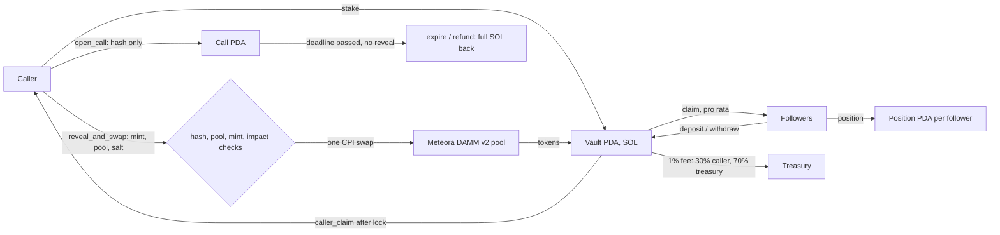

# SEALED CALL

**A memecoin caller and every follower buy the same token in ONE transaction, at ONE price, and nobody, not even a bot watching the mempool, sees the token until that transaction runs.**

What is new:

- **Sealed commit and reveal.** The caller puts only `sha256(call, mint, pool, salt)` on chain. Followers deposit blind; the token is unknowable until the reveal.
- **The whole vault fills in one swap.** `reveal_and_swap` swaps the caller's stake and every follower's SOL through Meteora DAMM v2 in a single instruction, so every claimant gets the same price (on devnet: a caller and three followers at 1.077e-9 SOL per token, tx `3TiDGb...jbj3bhdJ`).
- **The caller cannot front-run.** The caller's own tokens are in the same fill and stay locked after it, so there is no earlier, cheaper entry to sell into followers.
- **Token and pool guards on chain.** The reveal refuses mints with a live mint or freeze authority or value-taking Token-2022 extensions, and pools that are new, mostly unlocked, too thin, or past the follower-visible price impact limit.
- **A hardened reveal.** A hostile money-path audit of every lamport and token path found one way to block a reveal (a 1-lamport wSOL donation); it is fixed, upgraded on devnet and proven by a test. See [docs/MONEY-PATH-AUDIT.md](docs/MONEY-PATH-AUDIT.md).

## Live links

- App (Solana devnet): https://sealed-call.pages.dev
- Judge path, about 60 seconds, nothing to install: https://sealed-call.pages.dev/try/
- Recorded devnet call with a caller and three followers: https://sealed-call.pages.dev/call/?c=HaaRaA1TCG3YMHu8vCtoCr5jkrdgUP5PjjUJnUsEtnw3
- Program ID (devnet): `JBwReCk6DRFZREGjCfNiMQUsFFc66FSLBrejnjzKgU4N`

## The problem

On Solana, a caller posts a token address and followers buy after the post goes public. They fill one by one, a few seconds apart, into a pool the caller and the bots have already moved. Bundlers and snipers who see the call first buy in the slots before the followers. The result is that every follower gets a different price and the order of buyers decides who wins.

We measured this instead of assuming it. On Oct 10, 2026 we matched 17 X caller posts carrying pump.fun token addresses to GeckoTerminal 1-minute candles of each token's top pool. The median follower premium (5-minute volume-weighted price after the post vs the close of the posting minute) was -3.62%, with a range of -59.7% to +88.3%. So followers do not systematically overpay; what they face is wide price dispersion and front-running. Caveats: minute candles, not individual follower fills, and small callers (5 to 3.7K followers). Data: [docs/evidence/sealedcall-baseline.json](docs/evidence/sealedcall-baseline.json).

SEALED CALL removes the front-running and the price swing between the first and the last buyer: everyone in a call gets the same fill, in the same transaction.

## How it works

1. **Seal.** The caller opens a call with a 32-byte commitment, `sha256(call, mint, pool, salt)`, plus a stake, a cap, a reveal deadline, a caller lock and a max price impact. The call names no token on chain, only the hash.
2. **Follow.** Followers deposit SOL into the call's vault without knowing the token. They can withdraw any time before the reveal.
3. **Reveal and fill.** The caller sends `reveal_and_swap` with the mint, pool and salt. The program checks the hash, checks the pool (seasoned before the call opened, mostly locked liquidity, deep enough) and the mint (fixed supply, no freeze authority, no value-taking extensions), checks the price impact limit, and swaps the whole vault (caller stake plus followers) through Meteora DAMM v2 in **one swap at one price**.
4. **Claim.** Followers claim their tokens pro rata right away. The caller's share stays locked until the caller lock ends, so the caller cannot dump on followers.
5. **Lapse.** If the caller never reveals before the deadline, the reveal is refused and every follower can take a full refund with no fee. The call can be marked lapsed (`expire`) only after every follower has refunded.

## Sealed DBC launch on Meteora DBC

A token launched on a Meteora Dynamic Bonding Curve, bought by a sealed call's whole vault in **one swap** at reveal. The caller and every follower pay the same lamports per token on the curve, where buyers who race a launch one by one pay a different, rising price each.

What runs (program path, no off-chain shim):

- `reveal_and_swap_dbc` in `programs/sealed_call/src/instructions/reveal_dbc.rs` CPIs into the DBC program's `swap` (`programs/sealed_call/src/dbc.rs`: program `dbcij3LW...`, pool authority and event authority PDAs, `VirtualPool` layout read straight from the account). The vault wraps its SOL, swaps exact-in quote to base, measures tokens out by the vault's balance delta, and unwraps.
- The pool kind is part of the seal. A DBC seal is `sha256(call, mint, pool, salt, 0x01)`, a DAMM v2 seal keeps `sha256(call, mint, pool, salt)`, so a seal opens on exactly one venue. Tests reveal a DAMM v2 seal on the DBC branch and a DBC seal on the DAMM v2 branch: both revert with `HashMismatch`.
- The seal is made ahead of the launch: the DBC pool address is derived from (config, base mint), so the caller seals the call first and the launch lands afterwards on exactly those addresses.
- The DBC branch checks the pool is a live `VirtualPool` owned by DBC on the supplied config, trades the revealed mint against wSOL, has not completed its curve or migrated, and the mint has a fixed supply and no freeze authority. The call's max price impact, fixed at open, is enforced against the curve's spot price (the 1% curve fee counts as impact), and the caller's `minimum_amount_out` is enforced by the curve.
- `sdk/src/dbc.ts` holds the DBC pool decoder, the DBC seal hash and the `revealAndSwapDbcIx` builder. `tests/helpers-dbc.ts` launches a DBC config and pool with `@meteora-ag/dynamic-bonding-curve-sdk`.

On devnet (`scripts/devnet-dbc.ts`, signatures in [docs/DEVNET-EVIDENCE.md](docs/DEVNET-EVIDENCE.md)): call `DJ4udH4vKekpo9hpZE3YYxWKa8UKYtF8uptbmssiNzQX` sealed against DBC pool `8i2gKevppEuhNBkBQ1Yj52momH28gJTDxk4bS9No4wgW` ahead of its launch (open `2kU7NXrS...`), three blind follower deposits, the launch created on the committed addresses (config `2AFubgpV...`, pool `5xp785bM...`), then one reveal swap `5tineReKv1nj7A83fU7ex1U9kMYaGCmy2yWpFwyMB7FfZZ5fKwKY4sRX5qRmRqdpiR5SEX616d11TrHC3kBitiWk` that bought 81,721,290,574,508 base units for 0.1782 SOL in 134,336 compute units. The fill equals the DBC SDK quote for the whole vault, the curve's base reserve fell by exactly that amount, and the three follower claims (`4nvqGwtx...`, `23tWTiHW...`, `3LHyjYkT...`) are floor(tokens_out x deposit / total): a price spread of 1.000000000x across wallets. A twin launch with the same four buys landing one after another spread 1.1217x from first to last buyer.

## Architecture



**Program** (`programs/sealed_call`, Anchor 0.32.1), one file per instruction in `src/instructions/`:

| Instruction | What it does |
|---|---|
| `init_config`, `set_config`, `set_paused` | admin: fee, caller fee share, limits, pause switch |
| `open_call` | caller commits the hash, stake and call terms; fee terms are fixed at open |
| `deposit`, `withdraw` | follower adds SOL to the vault, or takes it back before reveal |
| `reveal_and_swap` | checks the commitment, pool and mint, then one CPI swap through DAMM v2 |
| `claim`, `caller_claim` | pro rata token claims; caller only after the lock (both run on devnet: follower claim `3mqyKr8i…`, caller claim after the 24 h lock `r2mGz2YM…`) |
| `refund`, `expire` | after an unrevealed deadline each follower refunds in full; `expire` marks the call lapsed once every follower has refunded |
| `sweep_dust` | admin cleanup of leftover rounding dust once every claim is done (run on devnet: `5FWG8Qfd…`) |

**PDAs:** `config` (`["config"]`), call (`["call", caller, call_id]`), vault (`["vault", call]`), position (`["pos", call, follower]`).

Other parts: `damm.rs` (DAMM v2 CPI and pool decoding), `math.rs` (pro rata, impact and fee split with checked u128), `state.rs` (Config, Call, Position), `events.rs` (an event on every state change). `programs/cpi_opener` is a small example program that opens a sealed call through CPI.

**SDK** (`sdk/`): TypeScript client with `fetchCalls`, `fetchPositions`, `fetchConfig` and instruction builders, built from the program IDL.

**App** (`app/`): Next.js static export on Cloudflare Pages with Phantom, Solflare or an in-browser burner wallet on devnet. It reads every Call account straight from chain; there is no database. Pages: the ledger (`/`), seal a call (`/open`), a call page for followers and the caller (`/call?c=`), and the judge path (`/try/`). Program errors are decoded from the IDL so a rejected reveal reads in plain words.

**Stats CLI** (`scripts/stats.ts`): reads calls executed, distinct followers, volume and the fee vault directly from chain.

## Setup and run

Prerequisites: Solana CLI 2.x, Anchor 0.32.1, Node 20+.

```bash
# program
npm install
anchor build && npm run sync-idl          # build program, refresh sdk/src/idl

# tests: local validator with real Meteora DAMM v2 dumped from devnet
npm test

# full open, deposit, reveal, claim and refund flow on devnet
npx tsx scripts/devnet-e2e.ts

# on-chain stats
npm run stats -- stats --rpc https://api.devnet.solana.com

# app
cd app && npm install && npm run dev      # set NEXT_PUBLIC_RPC_URL for a private RPC

# deploy app (Cloudflare Pages project "sealed-call")
cd app && npm run build && npx wrangler pages deploy out --project-name sealed-call --branch main

# upgrade program
anchor deploy --provider.cluster devnet
```

Note: `npm run deploy` in `app/` runs the design gate first and refuses to deploy while the design critic score is under 8, so use the `wrangler pages deploy` line above. See `HANDOFF.md` for IDL paths and the SDK surface.

## For judges: try it in 60 seconds

Open https://sealed-call.pages.dev/try/. Every step is a real devnet transaction.

1. **Wallet:** press "Use a burner wallet" (a throwaway devnet key kept in your browser), or connect Phantom or Solflare on devnet.
2. **Devnet SOL:** about 0.012 SOL is enough. Use https://faucet.solana.com/ (paste the address shown, pick devnet). The "Request 0.1 SOL here" button often hits the public RPC rate limit, so the faucet is the reliable path.
3. **Seal:** go to "Seal a call". The form is prefilled with the demo Meteora DAMM v2 pool `9mwSK2b1CL6knpy5A8SK2uv4UJfQ2P7FyKkbYiC19j8K`, a 0.006 SOL stake, a 0.04 SOL cap and a 60-minute window. Sign once.
4. **Reveal:** press "Open the call", then "Reveal with your stake only" (or "Reveal and fill everyone" once followers have deposited). One transaction checks the hash, swaps the vault and fills every row at one price.
5. **Optional follower:** open the call link in a private window, use a burner there, fund it, deposit 0.005 SOL, then reveal from the first window. The follower can claim at once; the caller's tokens stay locked for 24 hours by design.

No wallet? Open the recorded call above and press "Replay the reveal". In that run a caller and three followers all filled at 1.077e-9 SOL per token in one transaction (`3TiDGb...jbj3bhdJ`, 109,404 compute units). All recorded devnet signatures are in [demo/devnet-run.json](demo/devnet-run.json).

## Business model

- **Fee:** every filled vault pays 1% (`fee_bps` = 100), taken by the program inside the reveal transaction.
- **Split:** 30% of the fee goes to the caller (`caller_fee_share_bps` = 3000) and 70% to the protocol treasury (`math.rs::split_fee`). Both values are read from the on-chain Config, and each call snapshots them when it opens.
- **Lapsed calls are free:** if there is no reveal, everyone gets a full refund and no fee is charged.

So a caller earns only when followers actually fill next to them at the same price, not by selling into them.

## Demand evidence

All from real public posts, collected in `sol/gtm/sealed-call/DEMAND.md` and `USERS.md`:

- @milianstx (2026-09-10): "Transparent blockchains make existing market mechanisms impossible onchain." https://x.com/milianstx/status/2098040544744112212
- @slingoorio, sharing a caller's account: calling anything under 50K "gets bundled sniped and farmed" (https://x.com/slingoorio/status/2105210573663174817; readable again on Oct 12, 2026, text also archived in `research/demand/x/fx/`).
- @0xSatre on a dev buying 45% in block 0 while 5,000 wallets bought after: https://x.com/0xSatre/status/2105074051538391084
- @Demaux (about 52K followers): "Getting rugged and winning 30$ in 5 seconds": https://x.com/Demaux/status/2103424269648806316
- r/GMGNAI, u/TheProtester_1 (2026-09-13): "I'm obviously 1-2 seconds late and that makes me sell after the token has lost all the value": https://www.reddit.com/r/GMGNAI/comments/1wf6doe/copytrading/
- r/SolanaMemeCoins: "call channels are just exit liquidity": https://www.reddit.com/r/SolanaMemeCoins/comments/1umm7d8/reminder_that_call_channels_are_just_exit/
- Blackhat DYOR coverage: "Treat every caller call as a potential exit liquidity event until proven otherwise."

## Traction

On chain, Oct 12, 2026 (12:00 PM IST): 18 calls opened on the devnet program. `npm run stats` at 11:30 AM IST: 11 executed calls, 0.14355 SOL swapped at reveal, 0.003015 SOL in the treasury fee vault. Every path (seal, deposit, withdraw, reveal, claim, caller claim, refund, lapse, sweep) has a finalized devnet signature in [docs/DEVNET-EVIDENCE.md](docs/DEVNET-EVIDENCE.md).

There has been no external security audit. The program's guards are covered by the test suite below and by the internal [money-path audit](docs/MONEY-PATH-AUDIT.md), not by a third party.

## Built before vs during the hackathon

From the git history of this repo (all times IST):

- The first commit is on **Oct 3, 2026** (program spec and design system). There is no code in this repo from before that date, and no outside code base was carried in apart from open-source dependencies (Anchor, Meteora DAMM v2 as a dumped program for tests, Next.js, shadcn).
- **Oct 5:** the Anchor program (commit, deposit, reveal and swap through DAMM v2, claims, refunds, caller lock), the hardening of reveal checks, the TypeScript SDK, the integration tests, and the devnet deploy with a full end-to-end run.
- **Oct 9 to 10:** the web app, Cloudflare Pages deploy, the notary's ledger redesign, the business model and demand evidence.
- **Oct 11:** the 60-second judge path with a burner wallet, seeded demo callers on devnet, pitch material and the submission checklist.

All of it was written inside the Colosseum Solana World's Fair submission window, which closes Oct 13, 2026.

## Tests

`npm test` runs 60 tests against a local `solana-test-validator` with the real Meteora DAMM v2 and Dynamic Bonding Curve programs dumped from devnet. Areas covered:

- config setup and the admin pause (blocks open, deposit and reveal while withdraw still works; only the admin may pause)
- opening calls, the commitment bound to the call address (a copied commitment fails), non-caller reveal rejected
- deposits, withdrawals, per-follower and vault caps, the caller cannot deposit into their own call
- the single-transaction reveal and swap with the 1% fee split to treasury and caller
- pool guards: seasoning, locked liquidity, depth, max price impact
- mint guards: live mint or freeze authority, Token-2022 transfer-fee extension
- pro rata claims, the caller lock and caller claim after it, `sweep_dust`
- expiry and full refunds after an unrevealed deadline
- opening a call from a PDA through CPI (`tests/zz-cpi-opener.ts`, 3 tests)
- the Sealed DBC launch (`tests/sealed-dbc.ts`, 17 tests): seal made ahead of the launch, one-swap reveal equal to the DBC SDK quote, pro rata claims at one price, a racing control launch, seal-kind binding in both directions, wrong config, vaults and mint, price impact, curve slippage, completed curve

The open, deposit, withdraw, reveal, follower claim, caller claim after the lock, refund, expire, sweep and fee split paths also run on devnet, each with a finalized signature in [docs/DEVNET-EVIDENCE.md](docs/DEVNET-EVIDENCE.md).

## Program ID

`JBwReCk6DRFZREGjCfNiMQUsFFc66FSLBrejnjzKgU4N` on Solana devnet. Upgrade authority `DEawZW...`.


## License

Apache-2.0 / MIT.
